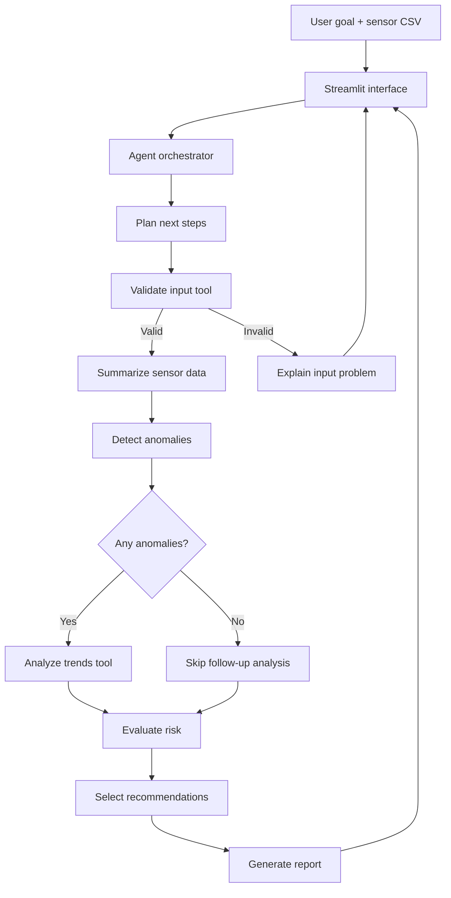

# IntelliMaintain — Agentic AI for Predictive Maintenance

IntelliMaintain is a small, explainable agentic AI prototype that analyzes machine sensor readings, selects diagnostic tools based on intermediate results, evaluates risk, and generates a maintenance report.

**Designed for a student project:** it runs without a paid API, API key, or internet connection after dependencies are installed.

## Why this demonstrates agentic behavior

The agent is more than a chat interface. It:
1. receives a user goal;
2. creates an explicit plan;
3. invokes tools to validate and summarize data;
4. detects sensor anomalies;
5. conditionally invokes trend analysis when anomalies exist;
6. evaluates the evidence and selects recommendations;
7. produces a report and an execution trace.

The workflow has a bounded planner–orchestrator design. When Ollama is available, the local LLM returns a structured JSON proposal naming optional tools; the orchestrator validates the proposal and uses it to decide whether to run optional trend analysis. Required validation, risk assessment, recommendations, and report generation remain controlled by Python. Anomalies always trigger trend follow-up, even if the model does not request it. If Ollama is unavailable, a deterministic fallback runs the workflow offline. This demonstrates constrained tool selection, not unrestricted autonomy or proven failure prediction.

## Features

- Built-in synthetic demo dataset with a deliberately rising vibration trend
- CSV upload for user-provided sensor readings
- Sensor trend visualization
- Input validation
- Configurable threshold and robust-deviation anomaly flags
- Conditional follow-up trend analysis
- Rule-based risk assessment and recommendations
- Agent execution trace
- Downloadable plain-text report
- Unit tests

## Architecture



## Repository structure

```text
IntelliMaintain/
├── app.py                 # Streamlit user interface
├── agent.py               # Agent planning and orchestration
├── tools.py               # Data tools and decision logic
├── requirements.txt
├── README.md
├── .gitignore
└── tests/
    └── test_agent.py
```

## Setup

Python 3.10+ is recommended.

### 1. Create and activate a virtual environment

**Windows PowerShell**
```powershell
python -m venv .venv
.venv\Scripts\Activate.ps1
```

**macOS/Linux**
```bash
python3 -m venv .venv
source .venv/bin/activate
```

### 2. Install packages

```bash
python -m pip install --upgrade pip
pip install -r requirements.txt
```

### 3. Run the application

```bash
streamlit run app.py
```

A browser tab should open. Leave “Use built-in demo data” enabled for the first demonstration, then click **Run agent analysis**.

### Optional: enable free local LLM planning

The project works without this step. For a stronger LLM demonstration, install [Ollama](https://ollama.com), start it, and download a model:

```bash
ollama pull llama3.2
```

Then restart the Streamlit app. If the local Ollama service is reachable, the model returns a JSON tool-selection proposal. The execution trace records the planner source, selected optional tools, rationale, and why trend analysis ran or was skipped. The orchestrator validates tool names and enforces mandatory stages and safety rules. No paid API key is used. If Ollama is not running, the application automatically uses the offline fallback plan.

### 4. Run tests

```bash
pytest -q
```

## CSV input format

The app accepts CSV files with at least five rows and at least one recognized numeric sensor column. Recognized columns:

| Column | Meaning | Illustrative threshold |
|---|---|---|
| `timestamp` | Reading timestamp (optional) | None |
| `vibration_mm_s` | Vibration velocity | High flag above 7.1 mm/s |
| `temperature_c` | Temperature | High flag above 85 °C |
| `rpm` | Rotational speed | Flag below 500 or above 4000 RPM |
| `current_a` | Current | High flag above 18 A |

Thresholds are **illustrative demo settings only**. Appropriate thresholds depend on asset type, sensor installation, operating conditions, and applicable standards. Do not use this prototype as the sole basis for real maintenance or safety decisions.

## How the agent decides what to do

- **Input validation:** stop and report a helpful error if the dataset is unusable.
- **Initial analysis:** summarize available sensor data and detect threshold or robust-deviation flags.
- **Conditional branch:** run trend analysis only when anomalies were found.
- **Risk assessment:** use transparent rules to assign LOW, MEDIUM, HIGH, or UNKNOWN.
- **Recommendations:** select follow-up actions based on risk level and the sensors flagged.
- **Stopping condition:** generate the report after the required analysis tools have run, or stop early if input validation fails.

The rules are intentionally visible in `tools.py` so the evaluator can inspect and test them.

## Planner policy and guardrails

- The LLM can request only allowlisted analysis tools.
- Required validation, risk assessment, recommendations, and reporting cannot be skipped.
- Unknown tool names or malformed JSON cause fallback to the deterministic planner.
- Anomaly findings always force trend follow-up, regardless of the LLM proposal.
- If no anomalies exist, a validated planner may request trend analysis when the user goal calls for it.
- The LLM never executes code or performs physical maintenance actions.

## Testing scenarios for a live demo

1. **Normal case:** modify demo data to keep all sensors within ordinary values; the agent should skip follow-up trend analysis if no anomalies remain.
2. **Abnormal case:** increase recent vibration or temperature readings; the agent should flag the signal and run trend analysis.
3. **Invalid case:** upload a CSV without any recognized sensor columns; the agent should stop and explain the input issue.
4. **Evidence trace:** expand the execution trace in the interface to show which tools ran and why.

## Limitations and future work

- Current anomaly and risk rules are illustrative and should be calibrated to a specific asset.
- Data is not connected to live industrial sensors.
- The prototype does not train a machine-learning failure prediction model.
- Future extensions could add a local LLM for natural-language planning, equipment-specific baselines, historical failure labels, and maintenance work-order integration.

## Academic integrity / description

Suggested project description:

> IntelliMaintain is an explainable agentic AI prototype for predictive maintenance. It uses a goal-driven orchestration loop, callable analysis tools, conditional tool selection, evidence-based risk rules, and report generation. It demonstrates tool use and adaptive workflow execution on synthetic or uploaded sensor data without relying on a paid LLM API.

## GitHub submission checklist

- [ ] App starts with `streamlit run app.py`
- [ ] Tests pass with `pytest -q`
- [ ] README and architecture schema are included
- [ ] Add screenshots of the running app to the repository
- [ ] Ensure no secrets, private data, or virtual environment are committed
- [ ] Create a public repository (if permitted by your course) and submit its URL
