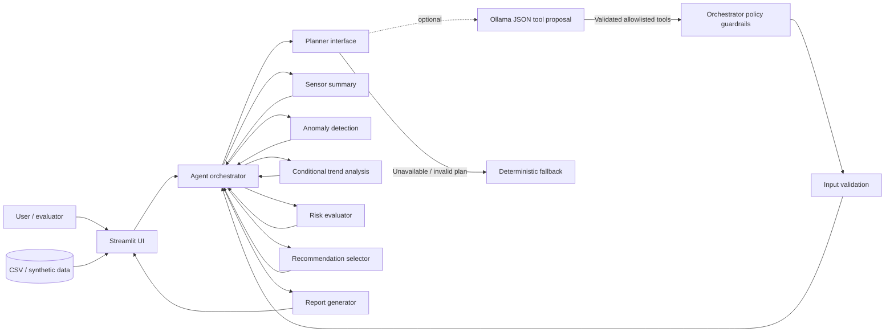
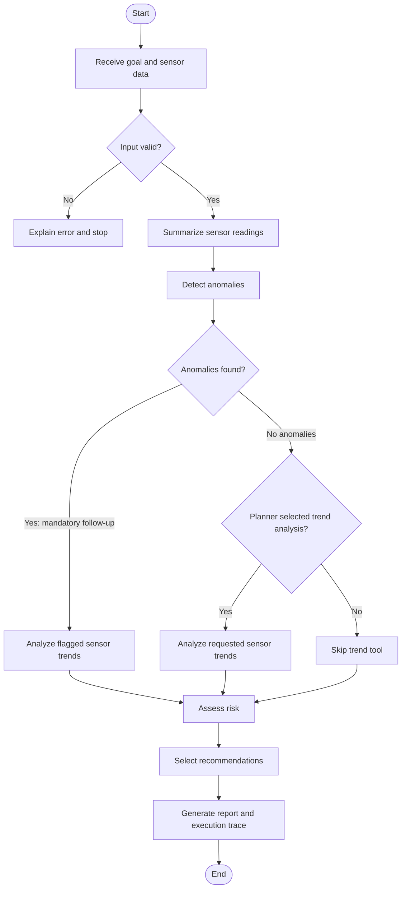

# IntelliMaintain development schema

## 1. High-level architecture

## 2. Workflow / decision schema

## 3. Component responsibilities

| Component | Responsibility |
|---|---|
| `app.py` | User interaction, CSV upload, visualization, results and report download |
| `agent.py` | Goal intake, planning, tool orchestration, conditional branch, trace |
| `tools.py` | Validation, sensor statistics, anomaly flags, trend analysis, risk and recommendations |
| `tests/test_agent.py` | Regression tests for validation, execution, and anomaly detection |

## 4. Data flow

1. The interface loads the synthetic dataset or a CSV uploaded by the user.
2. The agent validates the available sensor columns and minimum row count.
3. Sensor summary and anomaly tools return structured Python data.
4. If anomalies are found, the agent calls trend analysis for the affected sensors.
5. Risk rules and recommendations use the tool outputs.
6. The report generator combines the goal, evidence, decision, recommendations, and limitations.
7. The interface displays the trace and allows the report to be downloaded.

## 5. Planner policy

The optional local LLM returns a structured JSON proposal for optional tools. The orchestrator rejects unknown tool names and enforces a fixed safe order. Input validation, risk evaluation, recommendation selection, and report generation are mandatory. If anomalies are found, trend analysis is forced; if no anomalies are found, a validated planner can request trend analysis based on the user goal. If the local model is unavailable or its output is invalid, the deterministic fallback is used.
